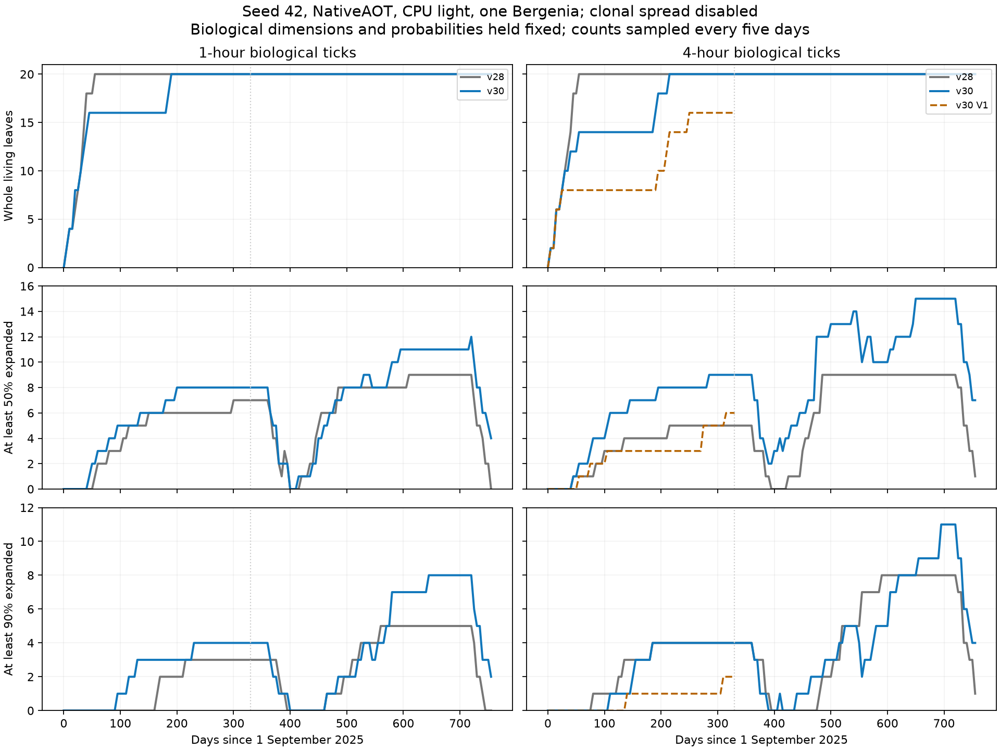

# Bergenia contact validation: selected v30

7 October 2026. This increment corrects unsafe tiny-motion admission and excess
subdivision of admissible persistent contacts. Developed foliage improves in the
four-hour NativeAOT case, but flowering and the doubled-density objective at both
tick sizes remain unresolved. Mode 0 remains the default; V1 and V2 have not
passed release gates.

## Implementation and provenance

Interval distance certificates reserve the combined material-point motion against
the existing 10 µm clearance tolerance. Root and midpoint tests use the same rule.
Attachment exclusions remain eroded by material and attachment-centre motion.
Tiny motion or a clear midpoint alone cannot authorize a trajectory. Bounded
subdivision retains distinct intersection and numerical-uncertainty outcomes.

The original +10 µm correction target, tissue coefficients, angular limits, work
budgets and botanical settings are preserved. Continuation gains diagnostic failure
classification. No per-organ state or geometry asset is added. Live checkpoint
**30** rejects older live states; payload and playback formats remain unchanged.

[selected-source.patch](selected-source.patch) isolates this increment against the
**starting dirty v28 source**, not repository HEAD. Unrelated changes are preserved.
Source, binary and evidence hashes are in [MANIFEST.json](MANIFEST.json).

## Controlled NativeAOT seasons

The [reconstructed archived request](request.json) starts 1 September 2025 with a
755-day horizon, one Bergenia, seed 42, CPU light, default terrain and disabled
clonal buds/spread. Only tick size and explicit V1 mode differ between cases.
Both source versions resolve today's predefined complex assets; identical archived
binary/assets are not established. Dimensions, 84-day expansion and crown
probabilities remain fixed. Ambient light is not used for calibration here.

| Case | Day 330: whole / ≥50% / ≥90% | Day 755: whole / ≥50% / ≥90% | Petals observed |
| --- | --- | --- | --- |
| v28, 1 h | 20 / 7 / 3 | 20 / 0 / 0 | No |
| v30, 1 h | 20 / 8 / 4 | 20 / 4 / 2 | No |
| v28, 4 h | 20 / 5 / 4 | 20 / 1 / 1 | No |
| v30, 4 h | 20 / 9 / 4 | 20 / 7 / 4 | No |
| v30-V1, 4 h | 16 / 6 / 2 | not run (330-day V1 case) | No |

Daily checks of tracked above-/below-ground resources remain finite; tickwise
maximum unresolved foliage contacts is zero. Finite values alone do not establish calibrated resource
magnitudes. Meristems are created but stall before buds/petals; commitment is not bloom.

Plots show five-day snapshots; threshold dates are observed daily. Bergenia has one
biological blade segment, so counts are whole organs. Expansion requires **both**
intrinsic attachment-axis length and half-width to reach the threshold of the sampled
target (preset plus variation offsets). These are linear dimensions, not area fractions.
Folding does not change those dimensions. Renewal creates a new stable leaf ID.

[RESULTS.json](RESULTS.json) records threshold completion and ages. First observation
has about one-day resolution. Completed-only durations have survivor bias; unreached
leaves may be delayed, retired or censored. Comparing those medians alone would misstate
growth rates. The 84-day setting remains provisional, not a botanical measurement.

At four-hour day 330, half-expanded leaves increase from five to nine; near-mature
leaves stay at four. At one hour the counts change from seven to eight and three to
four. This does not meet the doubled-density objective at both tick sizes.

## Dimensions and botanical limits

At four-hour day 330, median attachment-axis blade length changes from **60 to 106 mm**,
median petiole length from **46 to 54 mm**. Highest stem tips stay near **28–30 mm**
above the world origin, which places the seed 10 mm below the soil surface. Stem counts
include support segments; do not treat them as a universal botanical node count.

The selected largest attachment-axis blade is about **256 mm**, full blade envelope
about **285 mm**, and longest petiole about **140 mm**. Basal lobes explain the different
length definitions. These exceed the user's 'Rotblum' largest blade of **160 mm** and
petioles about **50 mm**, in a **195 mm** pot. Blade width and initial age remain unknown.
[DIMENSIONS.json](DIMENSIONS.json) and snapshot logs retain organ-level measurements.

The [RHS 'Rotblum' description](https://www.rhs.org.uk/plants/72444/bergenia-rotblum/details)
supports evergreen wavy foliage and stout spring scapes, but supplies no numerical
stiffness ratio, contact angle or expansion duration. Published upper sizes are not
targets for every developing leaf or this particular cultivated plant. No coefficient
was changed to compensate for contact stalls.

## Verification

- **16/16 fixtures per runtime:** managed .NET 8 and NativeAOT .NET 10, eight cases
  at 1 h/4 h. Includes radial/longitudinal growth, same-crown contact, V1 evasion,
  angular constraints, inward release, independent direct solve, confinement and
  exact rollback.
- **11 CCD cases per runtime:** refuse previously accepted tiny invalid starts;
  retain expected edge/wall, widening, rotation, basal-lobe and folded/curved decisions.
  Material-point sampling checks 190,080 points against motion bounds; sampling is
  not proof.
- **Published subset:** 304 representable queries from 324 rational examples.
  Both runtimes refuse all 145 collision-positive queries. Of 159 original negatives,
  126 are clear and 33 refused. Float conversion and 20 µm per-body offsets differ
  from the original benchmark. See [LITERATURE.md](LITERATURE.md) for exclusions.
- **Checkpoints:** native v30-origin day-240 states at both ticks, with and without
  removal/reindexing, reproduce immediate/continued state and exports byte for byte
  after cache rebuilding. Fresh, same-runtime mature and synthetic V1 cases also pass.
  Probe-only promotion of historical headers is not a production feature.
- **Scheduling/translation:** four plants with independent contact pairs reproduce
  state/exports with configured worker limits one/four. Four frozen fixtures retain
  identical growth after translation by several metres. Neither establishes
  large-scene speedup or universal translation invariance.
- **Build/interfaces:** prescribed core build passes, 298 existing warnings and zero
  errors; NativeAOT server publishes. Eight presets including Default serve sixteen
  leaf/petal meshes, byte-identical to the earlier unchanged-geometry server. Five
  frontend suites pass all 38 playback/geometry tests.

Single-precision geometry lacks outward-rounded interval arithmetic. The tolerance
permits minor finite-thickness proxy overlap. This evidence establishes neither exact
nonintersection nor static mechanical equilibrium.

## Performance

Three paired native processes per case, ten warmups and 35 retries, alternating order.
Task-owned long probes were paused/resumed for measurement. Values are the median of
process medians and median process p95.

| Fixed population | v28 median / p95 ms | v30 median / p95 ms | Median change |
| --- | --- | --- | --- |
| radial | 0.9626 / 0.9938 | 0.9926 / 1.0138 | +3.12% |
| radial same-crown | 0.8745 / 0.8883 | 0.8004 / 0.8074 | -8.47% |
| radial v1 | 30.1826 / 30.3708 | 30.1453 / 30.3137 | -0.12% |
| single | 0.6398 / 0.6785 | 0.6791 / 0.6915 | +6.14% |

The scoped ≤25% retry-time gate passes. This is not a dense-stand, full-growth,
CPU-light or FAV11/P003 end-to-end benchmark. Several retries still allocate about
11–20 KiB; the same-crown case records the harness stopwatch's 40 bytes. Zero steady
per-contact allocation is not achieved. No new persistent per-organ state is added,
but the complete V2 pair's 4 KiB target / 8 KiB ceiling remains uncertified.
Concurrent seasonal wall times are not performance comparisons.

Smaller correction gaps, more rigid rounds and a swept two-tree experiment were
rejected after biological, cost or certification regressions. Applying V1's reciprocal
path to rigid organs only in an isolated source copy improved a mature radial increment,
but failed to recover flowering/density through day 275 and increased work. None is
enabled. Earlier provisional benchmark files mislabeled a control executable; only
[verified-v30-benchmarks.json](verified-v30-benchmarks.json) is authoritative.

## Remaining gates

[DIAGNOSTICS.md](DIAGNOSTICS.md) isolates a native attached-petiole rejection at
nanometre scale near the tolerance boundary, and measures V1's accepted fold angles.
The next focused task is robust distance/interpolation predicates and retained path
witnesses, checked against double-precision references, preserving physical clearance.
No blanket tiny-motion exemption is justified.

Both versions show downward buds and some downward blade segments in the CPU/ambient
Carex comparison. Completed 100-day cases have no inversions or unresolved contacts.
The guide's blanket no-downward-axis expectation is not met; this is not a complete
posture pass. Long Carex horizons are labelled separately. Segmented blades are not
whole leaves, and different populations prevent fair whole-run timing comparisons.

Flowering, density at both ticks, V2 shell mechanics, integrated memory/allocations,
large-scene multicore scaling and the repaired 790-plant FAV11 panel remain open.
The [midterm research review](LITERATURE.md) supports the V2 direction, without
validating the current reduced-joint retry as a converged shell/contact solver.
